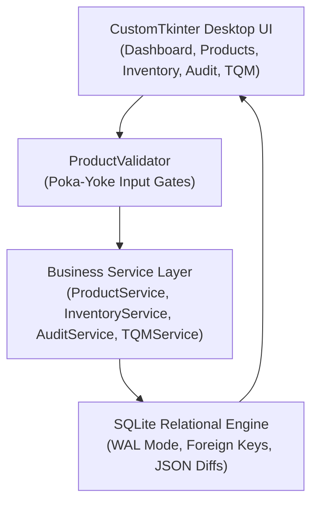

# Inventory Management System — Improving Data Accuracy Using Total Quality Management (Q07)

[](https://www.python.org/)
[](https://customtkinter.tomschimansky.com/)
[-green.svg)](https://www.sqlite.org/)
[](tests/)
[](docs/CTQ_Analysis.md)

---

## 1. Project Identity & Academic Context

- **Project Title**: Inventory Management System — Improving Data Accuracy Using Total Quality Management (Q07)
- **Student Name**: Dheeraj Khetwal
- **Course**: BBAT104 — Fundamentals of Total Quality Management
- **Academic Session**: 2026–27
- **Baseline System**: Inventory Management System
- **Assigned Quality Goal**: **Q07 — Improve Data Accuracy**

---

## 2. Problem Statement (The Cost of Poor Data Quality)

In traditional inventory systems, poor data accuracy leads to distorted financial valuations, stockout disruptions, and audit failures. The root causes of inaccurate records typically stem from:
1. **Unvalidated Text & Number Entries**: Typographical errors, negative stock quantities, and strings entered into monetary fields.
2. **Category Fragmentation**: Inconsistent naming variations (e.g., "elec", "Electronic", "Electronics") that fracture inventory reports and Pareto charts.
3. **Duplicate Stock Identifiers**: Redundant SKU codes assigned to different physical products.
4. **Untracked Stock Variances**: Manual stock adjustments applied without documentation or accountability.
5. **Accidental Deletions**: Unconfirmed destructive actions resulting in orphaned historical stock data.

**Quality Goal Q07 Objective**: Develop an enterprise-grade desktop inventory management application that minimizes incorrect entries, prevents invalid data at input gates (Poka-Yoke), maintains reliable product records, and provides an auditable history of all modifications.

---

## 3. Technology Stack

- **Python Runtime**: Python 3.11+ (Tested and verified on Python 3.14.5 64-bit)
- **User Interface**: `CustomTkinter` for modern, responsive desktop controls and dark-navy enterprise styling.
- **Relational Storage**: `SQLite3` with Foreign Key constraints enabled (`PRAGMA foreign_keys = ON;`), Write-Ahead Logging (`WAL`), and atomic ACID transaction semantics.
- **Statistical Graphics**: `Matplotlib` embedded via `FigureCanvasTkAgg` for Pareto charts and category distribution figures.
- **Automated Testing**: `pytest` for automated unit and integration tests.
- **Logging**: Python standard library structured logging writing to `logs/app.log` and console.

---

## 4. Key Application Features

### A. Executive Dashboard
- Real-time KPIs calculated from SQLite: Unique Products, Units in Stock, Total Valuation ($\sum \text{Qty} \times \text{Price}$), and Low-Stock Count.
- Embedded Matplotlib Category Valuation distribution bar chart.
- Real-time feed of recent audit events with action badges.
- Quick navigation shortcuts.

### B. Product Catalog Management (Complete CRUD)
- **Create**: Unique sequential ID generation (`PRD-1001`+), input masking, and audit logging.
- **Read**: Responsive table view with search, category filtering, and stock health indicators.
- **Update**: Edit catalog records with automatic diff computation and audit trail recording.
- **Delete**: Safe deletion protected by explicit confirmation modals with item summaries.

### C. Inventory & Stock Movement Ledger
- Dynamic stock health indicators: `OPTIMAL`, `REORDER`, `CRITICAL`.
- Audited Stock Adjustments requiring verified physical counts and mandatory business reasons.
- Discrete Stock Movements ledger tracking `INITIAL`, `IN`, `OUT`, and `ADJUSTMENT` transactions.

### D. Five Mandatory Q07 Features
1. **Feature 1: Input Masking & Strict Validation**: Poka-Yoke prevention of empty names, negative quantities, decimal stocks, invalid prices, and malformed SKUs.
2. **Feature 2: Controlled Dropdown Lists**: Category assignment strictly restricted to authoritative master taxonomy (`Electronics`, `Stationery`, `Furniture`, `Accessories`, `Raw Materials`, `Other`).
3. **Feature 3: Auto-complete Search**: Real-time debounced suggestion popover querying live database records by name or SKU code.
4. **Feature 4: Confirmation Modals**: CustomTkinter modal dialogs summarizing exact before/after impact prior to destructive or sensitive database modifications.
5. **Feature 5: Transactional Audit Logging**: Dedicated `audit_logs` table storing immutable JSON representations of old and new values for every catalog modification.

### E. TQM Quality & Analytics Suite
1. **Critical to Quality (CTQ) Scorecard**: Live compliance indicators for Quantity Accuracy, SKU Uniqueness, Data Completeness, Category Standardization, and Audit Traceability.
2. **Defect Checksheet & Log**: Structured logging of observed data inaccuracies, frequencies, severity, and resolution status.
3. **Pareto Analysis (80/20 Rule)**: Matplotlib dual-axis chart plotting sorted defect frequencies, cumulative percentage curve, and green dashed 80% cutoff line.
4. **Ishikawa (Fishbone) Diagram**: Cause-and-effect analysis covering the 4 course categories: People, Process, Software Code, and Infrastructure.
5. **Failure Mode and Effects Analysis (FMEA)**: Interactive worksheet computing Risk Priority Numbers ($RPN = \text{Severity} \times \text{Occurrence} \times \text{Detection}$) on a 1–10 scale.
6. **SIPOC Process Map**: Visual mapping of Suppliers, Inputs, Process Steps, Outputs, and Customers.
7. **PDCA Tracker**: Continuous improvement project tracker across Plan, Do, Check, and Act stages.

---

## 5. System Architecture



---

## 6. Project Folder Structure

```
Inventory_TQM_Project/
├── .gitignore                      # Git exclusion rules
├── requirements.txt                # Production & test dependencies
├── main.py                         # Application entry point
├── app/
│   ├── __init__.py
│   ├── config.py                   # System paths, constants & taxonomies
│   ├── database/
│   │   ├── __init__.py
│   │   ├── connection.py           # SQLite connection & transaction manager
│   │   └── schema.py               # DDL migrations, tables & seed data
│   ├── models/
│   │   ├── __init__.py
│   │   ├── product.py              # Product data entity
│   │   ├── audit_log.py            # AuditLog entity & JSON diff parser
│   │   ├── stock_movement.py       # StockMovement ledger entity
│   │   └── tqm.py                  # Defect, FMEAItem, PDCARecord entities
│   ├── services/
│   │   ├── __init__.py
│   │   ├── product_service.py      # Product CRUD, validation & search
│   │   ├── inventory_service.py    # Stock adjustments & valuation
│   │   ├── audit_service.py        # Audit queries & diff extraction
│   │   └── tqm_service.py          # CTQ, Pareto, FMEA, Fishbone & PDCA algorithms
│   ├── ui/
│   │   ├── __init__.py
│   │   ├── theme.py                # Enterprise design tokens & color palette
│   │   ├── app_window.py           # Main window & sidebar navigation
│   │   ├── components/
│   │   │   ├── __init__.py
│   │   │   ├── stat_card.py        # KPI metric card tile
│   │   │   ├── autocomplete_entry.py # Debounced popover search
│   │   │   ├── confirm_dialog.py   # Modal confirmation dialog (Q07 Feature 4)
│   │   │   └── table_view.py       # Scrollable data table with action buttons
│   │   └── views/
│   │       ├── __init__.py
│   │       ├── dashboard_view.py   # Dashboard & Category chart
│   │       ├── products_view.py    # Products CRUD & modals
│   │       ├── inventory_view.py   # Stock adjustments & movement ledger
│   │       ├── audit_view.py       # Audit history & JSON inspector
│   │       └── tqm_view.py         # CTQ, Pareto, Fishbone, FMEA, SIPOC, PDCA
│   └── utils/
│       ├── __init__.py
│       ├── logger.py               # Centralized logging setup
│       └── validators.py           # Strict validation & dict diff helper
├── tests/
│   ├── __init__.py
│   ├── conftest.py                 # Ephemeral test database fixtures
│   ├── test_validators.py          # 20 tests: Input masking & boundary conditions
│   ├── test_product_service.py     # 7 tests: CRUD, duplicate SKU & search
│   ├── test_inventory_service.py   # 6 tests: Stock adjustments & valuations
│   ├── test_audit_service.py       # 2 tests: Audit logs & ACID rollback safety
│   └── test_tqm_service.py         # 7 tests: FMEA RPN, Pareto 80/20 & CTQ
└── docs/
    ├── README.md                   # Docs index
    ├── SRS.md                      # Software Requirements Specification
    ├── System_Architecture.md      # Architecture & layered design
    ├── Database_Design.md          # ER diagram & relational schema
    ├── SIPOC.md                    # Process flow matrix
    ├── FMEA.md                     # Failure Mode & Effects Analysis worksheet
    ├── CTQ_Analysis.md             # Critical to Quality definitions & equations
    ├── Testing_Report.md           # Automated test results & matrix
    ├── PDCA_Log.md                 # Deming cycle continuous improvement logs
    ├── User_Manual.md              # Operator user guide & troubleshooting
    └── Known_Limitations.md        # Technical boundaries & assumptions
```

---

## 7. Installation & Quick Start

### 7.1 Prerequisites
- Python 3.11 or later installed on Windows.
- Visual Studio Code or Windows PowerShell.

### 7.2 Setup Environment
```powershell
# 1. Navigate to the project root directory
cd c:\Users\dheer\Downloads\Inventory_TQM_Project

# 2. Create Python virtual environment
py -m venv .venv

# 3. Activate the virtual environment
.\.venv\Scripts\Activate.ps1

# 4. Install all dependencies
pip install --upgrade pip
pip install -r requirements.txt
```

### 7.3 Run Application
```powershell
.\.venv\Scripts\python.exe main.py
```

### 7.4 Run Automated Tests
```powershell
.\.venv\Scripts\pytest tests/ -v
```

---

## 8. Database Location

- **File Path**: `data/inventory_tqm.db`
- **Engine**: SQLite 3 (WAL Mode enabled)
- **Safety**: Safe schema migrations check table existence on boot without dropping or overwriting existing databases.

---

## 9. TQM Tools & Methodologies Demonstrated

1. **Poka-Yoke (Mistake Proofing)**: Input masking and range validation preventing invalid data from ever entering the system.
2. **Standardization**: Controlled 6-category taxonomy eliminating inconsistent spellings.
3. **Traceability**: Transactional audit logging recording JSON diffs for all data mutations.
4. **CTQ Scorecard**: Real-time measurement of 5 data quality characteristics against 100% targets.
5. **Pareto Analysis**: 80/20 distribution chart identifying the vital few failure categories.
6. **Ishikawa (Fishbone) Diagram**: 4M root-cause exploration for data inaccuracy.
7. **FMEA (Failure Mode and Effects Analysis)**: Risk scoring ($RPN = S \times O \times D$) showing a 95.06% risk reduction post-implementation.
8. **SIPOC Process Map**: End-to-end supply chain workflow mapping.
9. **PDCA Cycle**: Structured Plan-Do-Check-Act improvement logging.

---

## 10. Known Limitations

- Single-user local desktop application (not multi-tenant SaaS or distributed enterprise ERP).
- Authentication: Runs locally without multi-user password management.
- For detailed technical boundaries, please see [Known_Limitations.md](docs/Known_Limitations.md).
