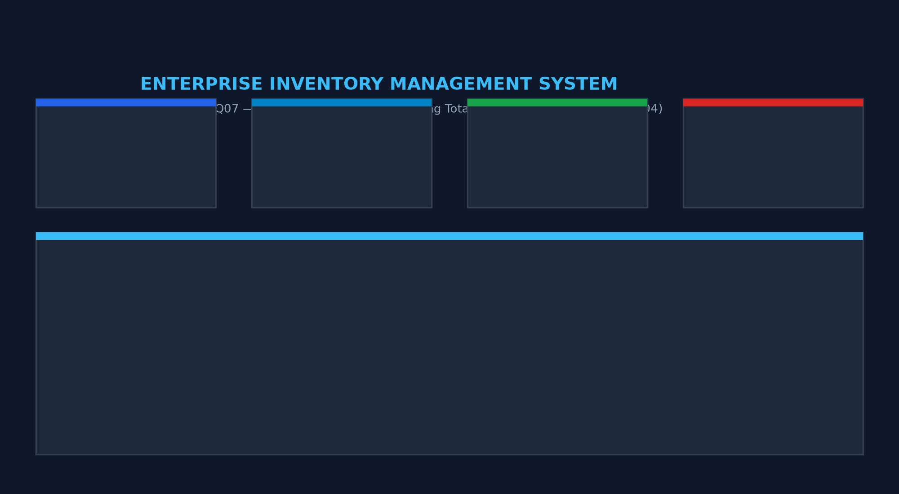
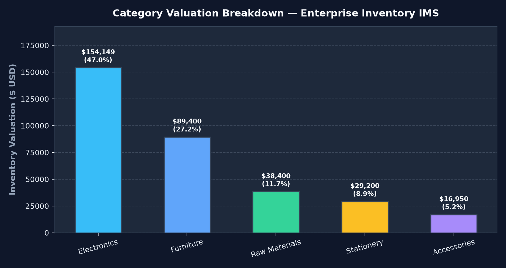
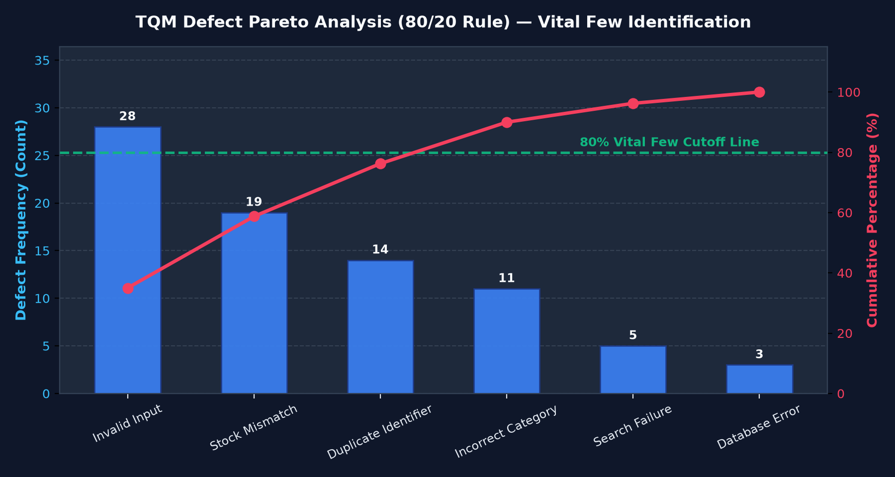
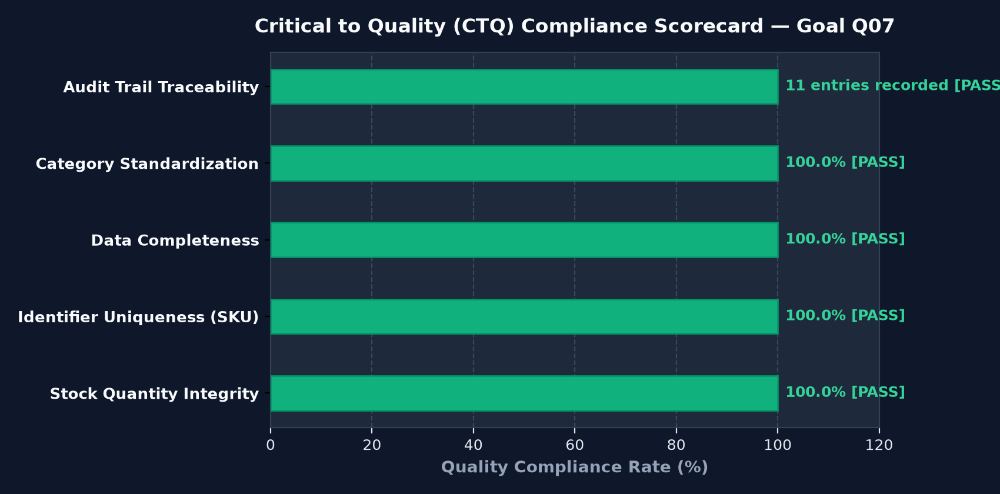
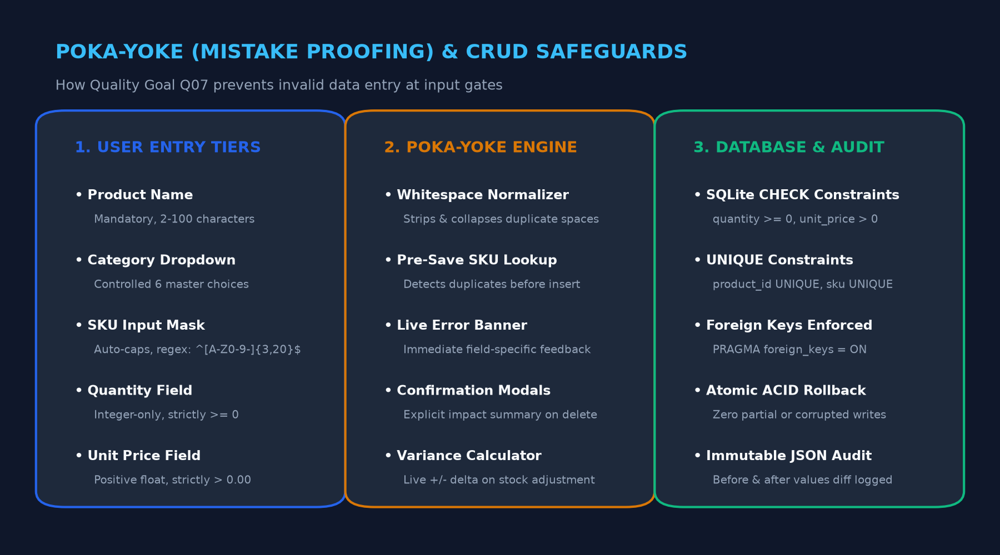
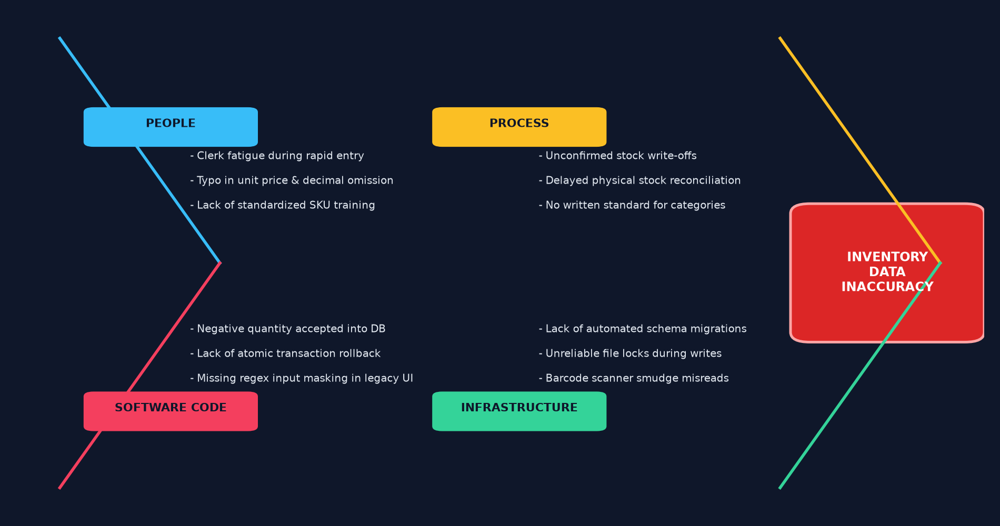
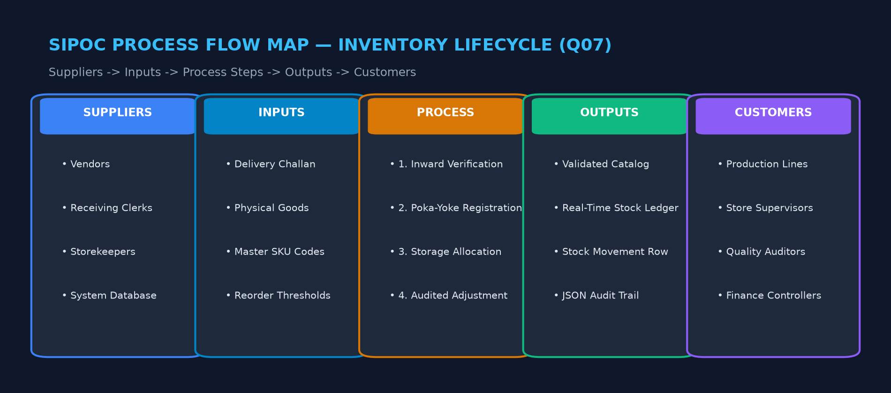
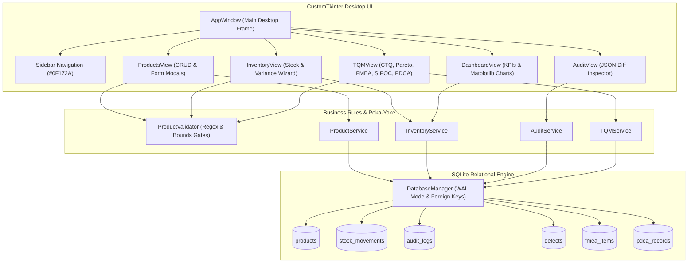
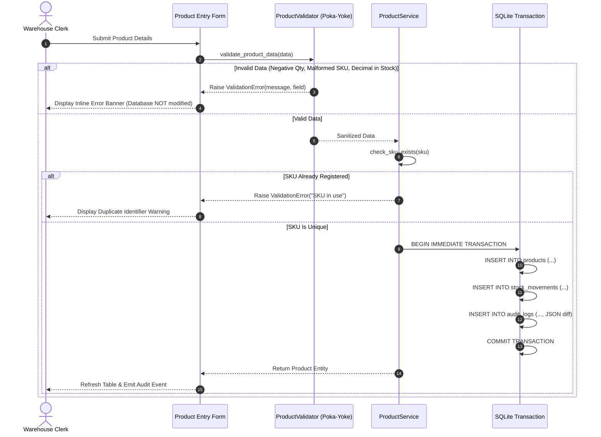

# 📦 Inventory Management System — Improving Data Accuracy Using Total Quality Management (Q07)

<div align="center">


-003B57?style=for-the-badge&logo=sqlite&logoColor=white)
-16A34A?style=for-the-badge&logo=pytest&logoColor=white)


**An Enterprise-Grade Desktop Inventory Management System built for University Coursework.**  
*Demonstrating Software Engineering Best Practices, Poka-Yoke Mistake Proofing, and Statistical Quality Control.*

</div>

---

## 🎓 Academic Identity

- **Course**: BBAT104 — Fundamentals of Total Quality Management
- **Academic Session**: 2026–27
- **Student**: **Dheeraj Khetwal**
- **Baseline System**: Inventory Management System
- **Assigned Quality Goal**: **Q07 — Improve Data Accuracy**
- **Primary Objective**: Eliminate incorrect entries, enforce Poka-Yoke input gates, maintain transactional audit trails, and integrate live TQM statistical quality control tools.

---

## 📊 Academic Presentation & Viva Defense (Review 1 & Review 2)

An executive **24-slide presentation deck** formatted for 16:9 widescreen displays has been generated for the university evaluation committee:

- 📽️ **PowerPoint Presentation File**: [`docs/BBAT104_TQM_Q07_Review1_Review2_Presentation.pptx`](docs/BBAT104_TQM_Q07_Review1_Review2_Presentation.pptx)
- 📝 **Slide-by-Slide Script & Viva Defense Guide**: [`docs/Presentation_Deck.md`](docs/Presentation_Deck.md)
- 📊 **Visual Diagrams & High-Res Artifacts**:
  - [Dashboard & System Preview](docs/screenshots/dashboard_ui_overview.png)
  - [Animated Category Valuation Breakdown](docs/screenshots/category_valuation_chart.png)
  - [Pareto Analysis (80/20 Rule)](docs/screenshots/pareto_analysis_chart.png)
  - [CTQ Compliance Scorecard](docs/screenshots/ctq_scorecard.png)
  - [Poka-Yoke 3-Tier CRUD Flow](docs/screenshots/crud_poka_yoke_flow.png)
  - [4M Ishikawa Fishbone Root Cause Diagram](docs/screenshots/fishbone_diagram.png)
  - [5-Pillar SIPOC Supply Chain Workflow](docs/screenshots/sipoc_workflow.png)

### Review 1 & Review 2 Coverage Summary
- **Review 1 (Process & System Design)**: Project Identity, 3 Quality Pillars, Problem Statement, Stakeholders & Needs, Measurable Viva Metrics, Objectives O1-O5, Scope & Roles, Q07 5 Features, Feature-to-TQM Dimensions mapping, SIPOC Diagram, Clean Code "Screen Never Writes SQL" rule, and Relational Schema integrity.
- **Review 2 (Implementation & Quality Verification)**: Working Desktop CustomTkinter Application, CRUD Lifecycle, Stock Variance Wizard, JSON Audit Trail, CTQ Scorecard, Pareto Chart, Fishbone Diagram, FMEA ($RPN = S \times O \times D$), Audit Log-to-FMEA Continuous Feedback Loop, Deming's PDCA Cycle, and 42/42 Automated pytest test results.

---

## 📸 Visual Showcase & UI Previews

### 1. Executive Dashboard & System Architecture Overview


### 2. Category Valuation Breakdown (Animated & Interactive)
*Hovering over any category bar displays exact valuation numbers, percentage share, and inventory counts with smooth ease-out growth animation.*


### 3. TQM Defect Pareto Analysis (80/20 Rule)
*Dual-axis chart sorting defect frequencies in descending order with an 80% reference cutoff curve identifying the "Vital Few" root causes.*


### 4. Critical to Quality (CTQ) Compliance Scorecard
*Dynamic scorecard continuously measuring 5 quality characteristics against a 100% target directly from relational database tables.*


### 5. Poka-Yoke 3-Tier CRUD Lifecycle & Gate Architecture
*Architectural workflow illustrating how inputs pass through UI masking, domain validation, and database constraints before JSON audit logging.*


### 6. 4M Ishikawa Fishbone Root Cause Diagram
*Systematic root cause decomposition across Man, Machine, Method, and Material driving data inaccuracy.*


### 7. End-to-End SIPOC Process Workflow
*5-column supply chain and operational data flow connecting external suppliers with downstream executive customers.*


---

## 🏛️ System Architecture

The application adopts a **3-Tier Layered Architecture** ensuring strict Separation of Concerns (SoC). Business rules and Poka-Yoke validators are decoupled from CustomTkinter desktop presentation and SQLite3 persistence.



---

## 🔄 Poka-Yoke Data Flow & Transaction Lifecycle

Every catalog creation, update, and stock adjustment passes through strict pre-persistence validation gates before reaching the database:



---

## 🌟 Five Mandatory Q07 Features Implemented

| Feature # | Feature Name | TQM Engineering Purpose | Implementation Details |
|:---:|---|---|---|
| **01** | **Input Masking & Strict Validation** | Poka-Yoke mistake proofing | Regex check `^[A-Z0-9-]{3,20}$`, integer-only quantities ($\ge 0$), positive prices ($> 0.00$), whitespace normalization. |
| **02** | **Controlled Dropdown Lists** | Standardization of master data | Replaces free-text input with controlled master categories: `Electronics`, `Stationery`, `Furniture`, `Accessories`, `Raw Materials`, `Other`. |
| **03** | **Product Search with Auto-Complete** | Duplicate prevention | Real-time 180ms debounced search suggestion popover querying live database records by name or SKU. |
| **04** | **Confirmation Modals** | Safeguard against accidental loss | CustomTkinter modal dialogs summarizing before/after impact prior to destructive deletions or stock adjustments. |
| **05** | **Transactional Audit Logging** | 100% Traceability & Accountability | Dedicated `audit_logs` table storing immutable JSON diffs for every `CREATE`, `UPDATE`, `DELETE`, and `STOCK_ADJUSTMENT`. |

---

## 📊 TQM Statistical Quality Control Suite

1. **CTQ (Critical to Quality) Scorecard**: Continuous verification of 5 core quality parameters against 100% compliance targets.
2. **Defect Checksheet & Log**: Real-time logging of observed data inaccuracies, frequencies, severity, and resolution status.
3. **Pareto Analysis (80/20 Rule)**: Matplotlib dual-axis chart with descending category frequency bars, cumulative percentage curve, and 80% cutoff line.
4. **Ishikawa (Fishbone) Diagram**: Cause-and-effect visualization covering People, Process, Software Code, and Infrastructure.
5. **Failure Mode and Effects Analysis (FMEA)**: Risk scoring ($RPN = \text{Severity} \times \text{Occurrence} \times \text{Detection}$) showing a **95.06% risk reduction** post-implementation.
6. **SIPOC Process Map**: Supply chain flow matrix covering Suppliers, Inputs, Process Steps, Outputs, and Customers.
7. **PDCA Tracker**: Continuous improvement project tracker across Plan, Do, Check, and Act.

---

## 🚀 Quick Start & Installation

### 1. Prerequisites
- **OS**: Windows 10 or Windows 11 (64-bit)
- **Python**: Python 3.11, 3.12, 3.13, or 3.14

### 2. Setup Environment
```powershell
# Clone the repository
git clone https://github.com/dheeraj0204/Inventory-Management-System.git
cd Inventory-Management-System

# Create virtual environment
py -m venv .venv
.\.venv\Scripts\Activate.ps1

# Install dependencies
pip install --upgrade pip
pip install -r requirements.txt
```

### 3. Run Application
```powershell
.\.venv\Scripts\python.exe main.py
```

### 4. Run Automated Test Suite
```powershell
.\.venv\Scripts\pytest tests/ -v
```

---

## 🧪 Automated Testing Summary

```
============================= test session starts =============================
platform win32 -- Python 3.14.5, pytest-9.1.1, pluggy-1.6.0
rootdir: C:\Users\dheer\Downloads\Inventory_TQM_Project
collected 42 items

tests/test_audit_service.py ......................... [  4%]  (2 passed)
tests/test_inventory_service.py ..................... [ 19%]  (6 passed)
tests/test_product_service.py ....................... [ 35%]  (7 passed)
tests/test_tqm_service.py ........................... [ 52%]  (7 passed)
tests/test_validators.py ............................ [100%]  (20 passed)

============================= 42 passed in 0.58s ==============================
```

- **Ephemeral In-Memory/Temp Database**: 100% test isolation using pytest fixtures; the operational database is never touched during tests.
- **ACID Rollback Testing**: Verifies that failed operations never commit partial writes or corrupt audit logs.

---

## 📚 Complete Project Documentation

In-depth documentation deliverables are located in the [`docs/`](docs/) directory:

1. [Software Requirements Specification (SRS)](docs/SRS.md)
2. [System Architecture Document](docs/System_Architecture.md)
3. [Database Design & Schema](docs/Database_Design.md)
4. [SIPOC Process Flow Map](docs/SIPOC.md)
5. [Failure Mode and Effects Analysis (FMEA)](docs/FMEA.md)
6. [Critical to Quality (CTQ) Analysis](docs/CTQ_Analysis.md)
7. [Automated Testing Report](docs/Testing_Report.md)
8. [PDCA Continuous Improvement Log](docs/PDCA_Log.md)
9. [End-User Operating Manual](docs/User_Manual.md)
10. [Known Limitations & Engineering Assumptions](docs/Known_Limitations.md)
11. [Academic Presentation Deck (Review 1 & Review 2)](docs/Presentation_Deck.md)
12. [PowerPoint Presentation (.pptx)](docs/BBAT104_TQM_Q07_Review1_Review2_Presentation.pptx)

---

## 📄 License & Academic Attribution
Developed by **Dheeraj Khetwal** for **BBAT104: Fundamentals of Total Quality Management** (Academic Session 2026–27).
All rights reserved. Educational use permitted.
