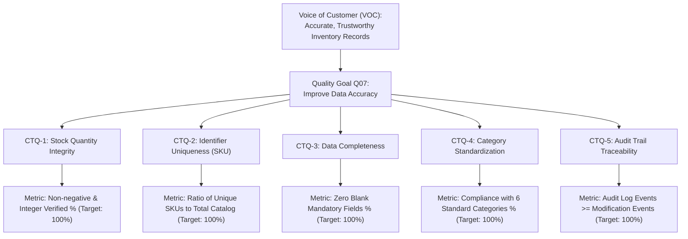

# Critical to Quality (CTQ) Analysis

## Operational Definitions & Metrics — Quality Goal Q07 (Improve Data Accuracy)

- **Student**: Dheeraj Khetwal
- **Course**: BBAT104 — Fundamentals of Total Quality Management
- **Academic Session**: 2026–27

---

## 1. Concept & Background in TQM

In Total Quality Management (TQM) and Six Sigma frameworks, **Critical to Quality (CTQ)** parameters represent the key measurable quality characteristics that a product or service must satisfy to meet customer requirements and quality standards.

For **Quality Goal Q07 (Improve Data Accuracy)**, the internal customers are warehouse operators, production managers, financial accountants, and auditors. Their primary quality requirement is **Data Reliability**: inventory numbers displayed on screen must reflect verified physical warehouse stock, with zero corrupt records, duplicate codes, or untraceable edits.

---

## 2. CTQ Tree Decomposition

---

## 3. Operational Definitions & Mathematical Formulas

### CTQ-1: Stock Quantity Integrity
- **Operational Definition**: The percentage of catalog products having an integer stock quantity greater than or equal to zero.
- **Formula**:
  $$\text{Quantity Accuracy \%} = \left( 1 - \frac{\text{Count}(\text{quantity} < 0)}{\text{Total Products}} \right) \times 100\%$$
- **Target**: $100.0\%$
- **Control Mechanism**: Dual validation via Python `ProductValidator.validate_quantity` and SQLite `CHECK (quantity >= 0)`.

### CTQ-2: Identifier Uniqueness (SKU)
- **Operational Definition**: The ratio of distinct Stock Keeping Unit (SKU) codes to the total number of products in the database.
- **Formula**:
  $$\text{SKU Uniqueness \%} = \left( \frac{\text{Count}(\text{DISTINCT sku})}{\text{Count}(\text{sku})} \right) \times 100\%$$
- **Target**: $100.0\%$
- **Control Mechanism**: Pre-save check via `ProductService.check_sku_exists` and database-level `UNIQUE` constraint on `products.sku`.

### CTQ-3: Data Completeness
- **Operational Definition**: The percentage of products that contain complete, non-whitespace data across all mandatory fields (Name, Category, SKU, Supplier, Unit Price $> 0$).
- **Formula**:
  $$\text{Completeness \%} = \left( 1 - \frac{\text{Count}(\text{Incomplete Records})}{\text{Total Products}} \right) \times 100\%$$
- **Target**: $100.0\%$
- **Control Mechanism**: `ProductValidator.validate_product_data` checking minimum character lengths and non-empty strings.

### CTQ-4: Category Standardization
- **Operational Definition**: The degree of conformity of catalog items to the 6 master classification groups (`Electronics`, `Stationery`, `Furniture`, `Accessories`, `Raw Materials`, `Other`).
- **Formula**:
  $$\text{Category Compliance \%} = \left( \frac{\text{Count}(\text{category} \in \text{Allowed})}{\text{Total Products}} \right) \times 100\%$$
- **Target**: $100.0\%$
- **Control Mechanism**: Replaced free-text entry with CustomTkinter `OptionMenu` controlled dropdown populated directly from application configuration constants.

### CTQ-5: Audit Trail Traceability
- **Operational Definition**: Complete historical coverage of every product creation, update, deletion, and stock movement transaction.
- **Formula**:
  $$\text{Audit Coverage Ratio} = \frac{\text{Count}(\text{audit\_logs})}{\text{Total Discrete Catalog Operations}}$$
- **Target**: $\ge 1.0$ (Every modifying event generates exactly one atomic audit log).
- **Control Mechanism**: Atomic database transactions bundling data modifications and audit log insertion within `DatabaseManager.transaction()`.

---

## 4. Live CTQ Scorecard Implementation

The live application dynamically computes these 5 metrics through `TQMService.calculate_ctq_metrics()` directly from SQLite tables. In the user interface, the **CTQ Scorecard** tab renders the target, actual measured value, and dynamic `PASS` / `FAIL` badge based on live database state.
