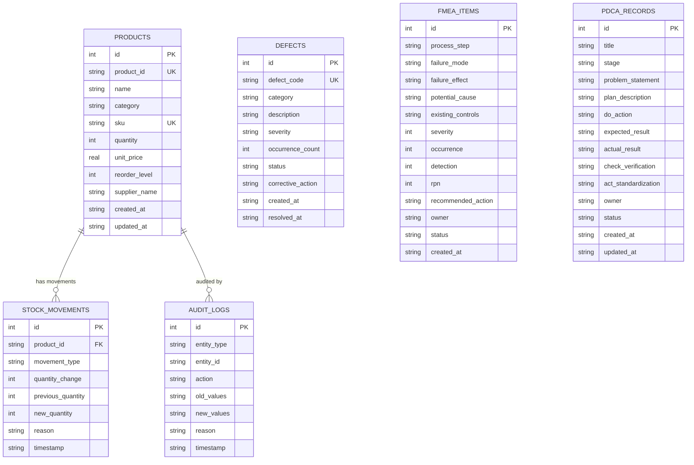

# Database Design Document

## Relational Schema & Integrity Constraints (SQLite3)

- **Student**: Dheeraj Khetwal
- **Course**: BBAT104 — Fundamentals of Total Quality Management
- **Academic Session**: 2026–27
- **Database Engine**: SQLite 3 (WAL Mode, Foreign Keys Enforced)

---

## 1. Entity-Relationship (ER) Diagram

---

## 2. Table Specifications & Data Dictionary

### 2.1 `products` Table
Primary catalog table holding Master Data for inventory items.

| Column | Type | Constraints | Description |
|---|---|---|---|
| `id` | `INTEGER` | `PRIMARY KEY AUTOINCREMENT` | Internal synthetic row identifier |
| `product_id` | `TEXT` | `NOT NULL UNIQUE` | Business identifier (e.g., `PRD-1001`) |
| `name` | `TEXT` | `NOT NULL` | Standardized product title (2–100 chars) |
| `category` | `TEXT` | `NOT NULL` | Controlled category taxonomy |
| `sku` | `TEXT` | `NOT NULL UNIQUE` | Stock Keeping Unit code (e.g., `ELEC-CAL-01`) |
| `quantity` | `INTEGER` | `NOT NULL CHECK (quantity >= 0)` | Verified units in stock (Enforces Q07 non-negative rule) |
| `unit_price` | `REAL` | `NOT NULL CHECK (unit_price > 0)` | Cost per item in currency (Enforces positive price) |
| `reorder_level`| `INTEGER` | `NOT NULL DEFAULT 5 CHECK (reorder_level >= 0)` | Low-stock alert threshold |
| `supplier_name`| `TEXT` | `NOT NULL` | Registered vendor or supplier |
| `created_at` | `TEXT` | `NOT NULL` | ISO 8601 UTC timestamp of creation |
| `updated_at` | `TEXT` | `NOT NULL` | ISO 8601 UTC timestamp of latest update |

### 2.2 `stock_movements` Table
Tracks discrete physical and financial stock transitions.

| Column | Type | Constraints | Description |
|---|---|---|---|
| `id` | `INTEGER` | `PRIMARY KEY AUTOINCREMENT` | Movement sequence ID |
| `product_id` | `TEXT` | `NOT NULL REFERENCES products(product_id) ON DELETE CASCADE` | Retained product reference |
| `movement_type`| `TEXT` | `NOT NULL CHECK (movement_type IN ('IN', 'OUT', 'ADJUSTMENT', 'INITIAL'))`| Transaction direction |
| `quantity_change`| `INTEGER`| `NOT NULL` | Discrete delta ($+N$ or $-N$) |
| `previous_quantity`| `INTEGER`| `NOT NULL` | Pre-movement inventory count |
| `new_quantity` | `INTEGER` | `NOT NULL CHECK (new_quantity >= 0)` | Post-movement count |
| `reason` | `TEXT` | `NOT NULL` | Mandatory audit explanation |
| `timestamp` | `TEXT` | `NOT NULL` | ISO 8601 UTC timestamp |

### 2.3 `audit_logs` Table (Q07 Feature 5)
Immutable append-only ledger for all catalog modifications.

| Column | Type | Constraints | Description |
|---|---|---|---|
| `id` | `INTEGER` | `PRIMARY KEY AUTOINCREMENT` | Unique audit event identifier |
| `entity_type` | `TEXT` | `NOT NULL DEFAULT 'PRODUCT'` | Type of entity modified |
| `entity_id` | `TEXT` | `NOT NULL` | Identifier of affected entity (`product_id`) |
| `action` | `TEXT` | `NOT NULL CHECK (action IN ('CREATE', 'UPDATE', 'DELETE', 'STOCK_ADJUSTMENT'))` | Action type classification |
| `old_values` | `TEXT` | `NULLABLE` | JSON-encoded snapshot of pre-modification values |
| `new_values` | `TEXT` | `NULLABLE` | JSON-encoded snapshot of post-modification values |
| `reason` | `TEXT` | `NULLABLE` | Documented reason provided by operator |
| `timestamp` | `TEXT` | `NOT NULL` | ISO 8601 UTC timestamp |

### 2.4 `defects` Table
TQM quality checksheet data capturing data inaccuracies and resolution progress.

| Column | Type | Constraints | Description |
|---|---|---|---|
| `id` | `INTEGER` | `PRIMARY KEY AUTOINCREMENT` | Internal sequence |
| `defect_code` | `TEXT` | `NOT NULL UNIQUE` | Defect record number (`DEF-1001`) |
| `category` | `TEXT` | `NOT NULL` | Defect group (e.g., `Invalid Input`, `Stock Mismatch`) |
| `description` | `TEXT` | `NOT NULL` | Root occurrence description |
| `severity` | `TEXT` | `NOT NULL CHECK (severity IN ('Low', 'Medium', 'High', 'Critical'))` | Impact classification |
| `occurrence_count`| `INTEGER`| `NOT NULL DEFAULT 1 CHECK (occurrence_count >= 1)` | Observed frequency |
| `status` | `TEXT` | `NOT NULL DEFAULT 'Open' CHECK (status IN ('Open', 'Under Review', 'Resolved'))` | Resolution status |
| `corrective_action`| `TEXT`| `NULLABLE` | Documented corrective/preventive action |
| `created_at` | `TEXT` | `NOT NULL` | Incident date |
| `resolved_at` | `TEXT` | `NULLABLE` | Resolution completion date |

### 2.5 `fmea_items` Table
Failure Mode and Effects Analysis worksheet storing risk priority scores.

| Column | Type | Constraints | Description |
|---|---|---|---|
| `id` | `INTEGER` | `PRIMARY KEY AUTOINCREMENT` | FMEA item ID |
| `process_step` | `TEXT` | `NOT NULL` | Target inventory workflow phase |
| `failure_mode` | `TEXT` | `NOT NULL` | Potential failure mechanism |
| `failure_effect`| `TEXT` | `NOT NULL` | Downstream impact on operations |
| `potential_cause`| `TEXT` | `NOT NULL` | Underlying root cause |
| `existing_controls`| `TEXT`| `NOT NULL` | Current prevention / detection mechanisms |
| `severity` | `INTEGER` | `NOT NULL CHECK (severity BETWEEN 1 AND 10)` | Severity score (1 = minor, 10 = critical) |
| `occurrence` | `INTEGER` | `NOT NULL CHECK (occurrence BETWEEN 1 AND 10)` | Likelihood of occurrence (1 = rare, 10 = certain) |
| `detection` | `INTEGER` | `NOT NULL CHECK (detection BETWEEN 1 AND 10)` | Ease of detection (1 = certain detection, 10 = undetectable) |
| `rpn` | `INTEGER` | `NOT NULL` | Generated score: $RPN = S \times O \times D$ |
| `recommended_action`| `TEXT` | `NOT NULL` | Corrective/preventive measure |
| `owner` | `TEXT` | `NOT NULL` | Assigned responsible engineer |
| `status` | `TEXT` | `NOT NULL DEFAULT 'Open'` | Implementation status |
| `created_at` | `TEXT` | `NOT NULL` | Creation date |

### 2.6 `pdca_records` Table
Continuous improvement tracking across the 4 TQM stages.

| Column | Type | Constraints | Description |
|---|---|---|---|
| `id` | `INTEGER` | `PRIMARY KEY AUTOINCREMENT` | Record ID |
| `title` | `TEXT` | `NOT NULL` | Continuous improvement project title |
| `stage` | `TEXT` | `NOT NULL CHECK (stage IN ('PLAN', 'DO', 'CHECK', 'ACT'))` | Active TQM phase |
| `problem_statement`| `TEXT` | `NOT NULL` | Quantified problem definition |
| `plan_description` | `TEXT` | `NOT NULL` | Proposed methodology |
| `do_action` | `TEXT` | `NULLABLE` | Executed trial steps |
| `expected_result` | `TEXT` | `NULLABLE` | Hypothesized outcome |
| `actual_result` | `TEXT` | `NULLABLE` | Measured empirical findings |
| `check_verification` | `TEXT`| `NULLABLE` | Analytical validation |
| `act_standardization`| `TEXT`| `NULLABLE` | Policy / operational standard update |
| `owner` | `TEXT` | `NOT NULL` | Initiative owner |
| `status` | `TEXT` | `NOT NULL DEFAULT 'Planned'` | Progress status |
| `created_at` | `TEXT` | `NOT NULL` | Start timestamp |
| `updated_at` | `TEXT` | `NOT NULL` | Latest stage advancement timestamp |

---

## 3. Database Indexes

To guarantee sub-millisecond query performance for auto-complete lookups and filtered analytics, explicit B-tree indexes are defined:

1. `idx_products_sku` on `products(sku)`: Instant uniqueness lookups and barcode queries.
2. `idx_products_name` on `products(name)`: Accelerated case-insensitive prefix search.
3. `idx_products_category` on `products(category)`: Instant category filter queries.
4. `idx_stock_movements_prod` on `stock_movements(product_id)`: Fast product movement ledger lookups.
5. `idx_stock_movements_time` on `stock_movements(timestamp)`: Chronological ledger ordering.
6. `idx_audit_entity` on `audit_logs(entity_id)`: Historical lookup by product.
7. `idx_audit_action` on `audit_logs(action)`: Fast action filter slicing.
8. `idx_audit_timestamp` on `audit_logs(timestamp)`: Chronological audit feed.
9. `idx_defects_category` on `defects(category)`: Pareto distribution aggregation queries.
