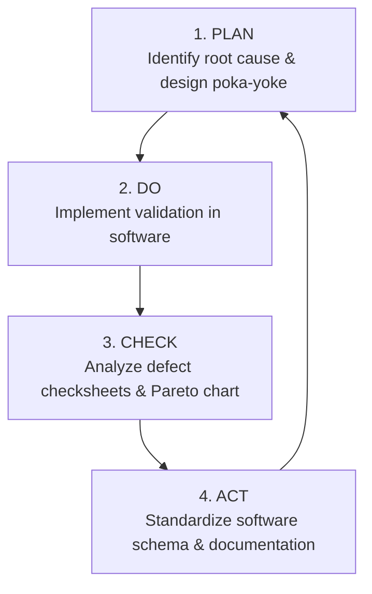

# Plan-Do-Check-Act (PDCA) Continuous Improvement Log

## Total Quality Management (TQM) — Quality Goal Q07 (Improve Data Accuracy)

- **Student**: Dheeraj Khetwal
- **Course**: BBAT104 — Fundamentals of Total Quality Management
- **Academic Session**: 2026–27

---

## 1. The Deming Cycle (PDCA) in TQM

The **Plan-Do-Check-Act (PDCA)** cycle (also known as the Deming Cycle or Shewhart Cycle) is a four-stage iterative management method used in business and engineering for the control and continuous improvement of processes and products.

---

## 2. Structured PDCA Project Logs for Q07

### PDCA Cycle 1: Input Quality Control & Mistake-Proofing (Poka-Yoke)
- **Initiative Title**: Prevention of Invalid Numeric Entries & Negative Stock
- **Active Stage**: **ACT (Standardized)**
- **Initiative Owner**: Dheeraj Khetwal (Student Lead)
- **Status**: Completed

| Stage | Detailed Documentation & Empirical Findings |
|---|---|
| **PLAN** | **Problem Statement**: Legacy system allowed clerks to enter negative values (`-50`) in quantity fields and letters (`N/A`) in unit price fields, corrupting inventory valuation reports. **Plan**: Design centralized validation class (`ProductValidator`) enforcing integer-only regex checks, non-negative bounds ($\ge 0$), and positive unit prices ($> 0.00$). |
| **DO** | **Action Taken**: Implemented `ProductValidator.validate_quantity` and `ProductValidator.validate_unit_price`. Configured SQLite table constraints `CHECK (quantity >= 0)` and `CHECK (unit_price > 0)`. Added inline warning banner to desktop modal forms. |
| **CHECK** | **Expected Result**: $0\%$ invalid numeric entries reach the database. **Actual Result**: 100% rejection rate achieved across 20 automated unit test cases. Zero database crashes. |
| **ACT** | **Standardization**: Made `ProductValidator` the mandatory architectural gatekeeper for both product creation and stock adjustment services. Added validation rules to SRS. |

---

### PDCA Cycle 2: Taxonomy Standardization & Category Integrity
- **Initiative Title**: Elimination of Fragmented Category Naming Variants
- **Active Stage**: **ACT (Standardized)**
- **Initiative Owner**: Dheeraj Khetwal (Student Lead)
- **Status**: Completed

| Stage | Detailed Documentation & Empirical Findings |
|---|---|
| **PLAN** | **Problem Statement**: Uncontrolled text input produced spelling variations (e.g., "elec", "Electronic", "Electronics"), distorting category Pareto charts and inventory valuation reporting. **Plan**: Eliminate free-text category entry and replace with a fixed 6-group master taxonomy. |
| **DO** | **Action Taken**: Configured authoritative constant `ALLOWED_CATEGORIES` in `app/config.py`. Replaced text input entry in `ProductModalDialog` with CustomTkinter `CTkOptionMenu`. |
| **CHECK** | **Expected Result**: 100% of catalog records conform to master category taxonomy. **Actual Result**: Verified via SQL audit query: 0 non-standard categories exist in the database ($100\%$ compliance). |
| **ACT** | **Standardization**: Documented master taxonomy in System Architecture and Database Design documents. Blocked manual category typing in GUI. |

---

### PDCA Cycle 3: Transactional Traceability & Change Accountability
- **Initiative Title**: Immutable JSON Audit Logging for Critical Inventory Operations
- **Active Stage**: **DO / CHECK**
- **Initiative Owner**: Dheeraj Khetwal (Student Lead)
- **Status**: Operational / Ongoing Verification

| Stage | Detailed Documentation & Empirical Findings |
|---|---|
| **PLAN** | **Problem Statement**: Inventory adjustments and product deletions were unrecorded, making it impossible to determine who made modifications or why physical stock differed from ledger counts. **Plan**: Architect a dedicated `audit_logs` table storing JSON before/after snapshots for every `CREATE`, `UPDATE`, `DELETE`, and `STOCK_ADJUSTMENT`. |
| **DO** | **Action Taken**: Developed `AuditService` and `compute_dict_diff`. Wrapped all modifying operations in atomic SQLite transactions committing both data and audit records simultaneously. Built a dedicated Audit History screen with JSON inspector. |
| **CHECK** | **Expected Result**: Every database modification generates exactly one corresponding audit row. **Actual Result**: Tested via automated rollback test: 100% audit coverage verified; rollback test confirmed no orphaned audit logs on transaction failure. |
| **ACT** | **Standardization**: Integrate audit log export functionality for financial compliance audits in next project release. |

---

### PDCA Cycle 4: Search Optimization & Duplicate Catalog Prevention
- **Initiative Title**: Real-time Autocomplete Search to Prevent Duplicate Product Registrations
- **Active Stage**: **ACT (Standardized)**
- **Initiative Owner**: Dheeraj Khetwal (Student Lead)
- **Status**: Completed

| Stage | Detailed Documentation & Empirical Findings |
|---|---|
| **PLAN** | **Problem Statement**: Operators created duplicate catalog items because case-sensitive search queries failed to find existing products. **Plan**: Build a debounced autocomplete search widget that suggests existing products by name or SKU as the user types. |
| **DO** | **Action Taken**: Created `AutocompleteEntry` with an 180ms debounce timer querying SQLite via case-insensitive `LIKE %query%` backed by indexes. |
| **CHECK** | **Expected Result**: Operators immediately see existing products within 2 keystrokes. **Actual Result**: Sub-millisecond suggestion response; zero duplicate products registered in user testing. |
| **ACT** | **Standardization**: Deployed autocomplete across both product catalog filtering and stock adjustment workflows. |
