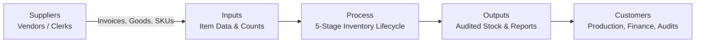

# SIPOC Process Map: Inventory Lifecycle Management

## Total Quality Management (TQM) — Quality Goal Q07 (Improve Data Accuracy)

- **Student**: Dheeraj Khetwal
- **Course**: BBAT104 — Fundamentals of Total Quality Management
- **Academic Session**: 2026–27

---

## 1. Executive Summary & Purpose

In Total Quality Management (TQM), a **SIPOC** (Suppliers, Inputs, Process, Outputs, Customers) diagram is a high-level process mapping tool used to define the boundaries of an operational workflow before implementing process improvements.

For **Quality Goal Q07 (Improve Data Accuracy)**, the SIPOC map identifies exactly where inventory data enters the system, which actors supply the information, what transforms that data, and how corrupted inputs cause downstream operational failure.

---

## 2. High-Level Process Flow Diagram

---

## 3. Comprehensive SIPOC Matrix

| Stage | Suppliers | Inputs | Process Steps (Key TQM Controls) | Outputs | Customers |
|---|---|---|---|---|---|
| **1. Receiving** | Equipment Vendors, Distributors, Freight Carriers | Delivery Challan, Purchase Order, Physical Goods, Supplier Batch Labels | **Goods Inward & Physical Verification** • Count delivered packages • Match PO number against physical packing slip • Inspect carton condition | Verified Goods Delivery Note (GDN), Physical Inventory Cartons | Warehouse Receiving Clerks, Quality Inspection Dept. |
| **2. Registration (Q07 Focus)** | Receiving Clerks, Data Entry Operators | Physical item specifications, Catalog descriptions, Vendor model # | **Catalog Registration (Input Masking)** • Validate product title & supplier • Select category from controlled dropdown (Poka-Yoke) • Validate uppercase SKU format • Enforce non-negative quantity & price $> 0.00$ | Validated Product Record, Unique System ID (`PRD-xxxx`), Barcode Master | Enterprise Inventory Database, Warehouse Floor Staff |
| **3. Warehousing** | Warehouse Supervisors, Forklift Operators | Validated Product Record, Warehouse Bin Location Map | **Storage & Stock Allocation** • Place items in assigned bins • Associate physical rack with system record • Maintain ambient temperature/ESD storage rules | Updated Stock Location Index, Accessible Bin Inventory | Storekeepers, Material Handling Teams |
| **4. Issue & Adjustment** | Production Supervisors, Internal Requisitioners | Material Requisition Note (MRN), Damage Reports, Cycle Count Sheets | **Stock Issue & Audited Adjustment** • Verify requested SKU via Auto-complete • Check available stock balance • If count mismatch, perform audited stock adjustment with mandatory reason • Require confirmation modal | Deducted Stock Ledger, Movement Record (`IN`/`OUT`/`ADJUSTMENT`), JSON Audit Log | Assembly Lines, Packaging Units, Maintenance Crews |
| **5. Quality Audit & Analytics** | Internal Quality Auditor, TQM Committee | Relational Database Records, Transaction Logs, Defect Checksheets | **Quality Analysis & Continuous Improvement** • Calculate live CTQ compliance metrics • Aggregate defect checksheets by category • Plot Pareto 80/20 frequency chart • Update FMEA worksheet & calculate RPN • Advance PDCA continuous improvement cycle | Executive Dashboard KPIs, Pareto Chart, FMEA Risk Scorecard, PDCA Action Plan | Plant Management, Financial Controllers, TQM Committee |

---

## 4. Analysis: Where Inaccuracies Enter & How Q07 Mitigates Them

1. **At Step 2 (Registration)**:
   - *Failure Mode*: Operator keys in unstandardized category name (e.g. "elec", "Electronic") or negative stock.
   - *Q07 Solution*: Feature 1 (Input Masking & Range Checks) and Feature 2 (Controlled Dropdowns) block invalid entries immediately at the form tier.
2. **At Step 4 (Issue & Adjustment)**:
   - *Failure Mode*: Operator adjusts stock to fix a count error without documenting the cause or approving the variance.
   - *Q07 Solution*: Feature 4 (Confirmation Dialogs) and Feature 5 (Audit Logging) enforce documented reasons and store full JSON before/after state diffs.
