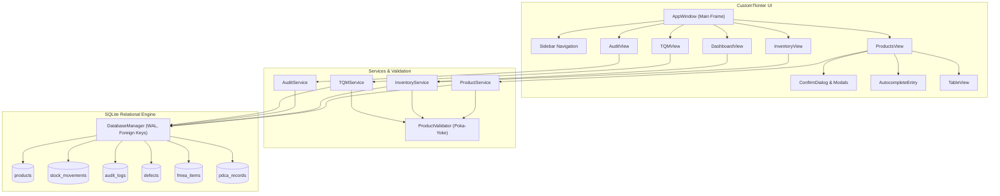
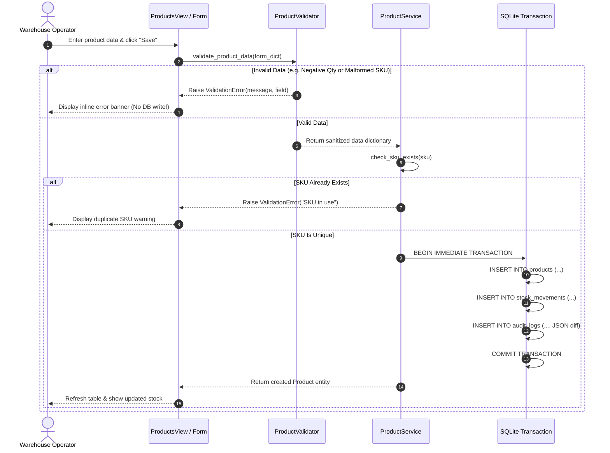

# System Architecture & Technical Design

## Inventory Management System — TQM Q07 Data Accuracy

- **Author**: Dheeraj Khetwal
- **Course**: BBAT104 — Fundamentals of Total Quality Management
- **Academic Session**: 2026–27

---

## 1. Architectural Overview

The application follows a clean, modular **3-Tier Layered Architecture** adhering to the **Separation of Concerns (SoC)** principle. Business logic and validation are isolated from graphical presentation and raw SQLite storage.

---

## 2. Layer Definitions

### 2.1 Presentation Tier (`app/ui/`)
- **`AppWindow`**: Hosts the persistent enterprise navigation sidebar, brand metadata, and manages dynamic frame swapping.
- **`DashboardView`**: Renders high-level KPI cards, embedded Matplotlib category distribution chart, and live audit feed.
- **`ProductsView`**: Complete CRUD interface with debounced autocomplete search, category filter, and modal forms.
- **`InventoryView`**: Real-time stock valuation ledger, low-stock threshold monitoring, and audited adjustment modal.
- **`AuditView`**: Immutable audit event browser with action-based filtering and JSON diff side-by-side inspection.
- **`TQMView`**: Multi-tab analytical workstation containing CTQ scorecard, Matplotlib Pareto 80/20 chart, Ishikawa 4M diagram, FMEA worksheet, SIPOC map, and PDCA tracker.
- **Custom Components**:
  - `StatCard`: Standardized KPI tile with accent bar and metric labels.
  - `ConfirmDialog`: Modal confirmation for destructive operations with structured impact summaries.
  - `AutocompleteEntry`: Real-time debounced popover querying live SQLite records.
  - `TableView`: Scrollable tabular grid with alternating rows, status highlight tokens, and action buttons.

### 2.2 Service & Business Rules Tier (`app/services/` & `app/utils/`)
- **`ProductValidator`**: Implements **Poka-Yoke (mistake-proofing)** rules:
  - Text normalization: Strips leading/trailing whitespace and collapses repeated internal spaces.
  - SKU format enforcement: Regex validation ensuring uppercase alphanumeric codes with hyphens.
  - Category restriction: Mandatory match against authoritative `ALLOWED_CATEGORIES` list.
  - Numeric integrity: Strictly parses whole integers for quantities ($\ge 0$) and floats ($> 0.00$) for prices.
- **`ProductService`**: Orchestrates product catalog lifecycle, ID generation (`PRD-1001`+), SKU collision checks, and emits audit events.
- **`InventoryService`**: Calculates stock valuation ($\sum \text{Qty} \times \text{Price}$), applies stock level changes, and enforces transaction logging with reasons.
- **`AuditService`**: Queries audit events and decodes JSON-serialized previous and new value snapshots.
- **`TQMService`**: Computes live CTQ metrics, generates Pareto frequency distribution and 80% cutoff curves, calculates FMEA RPN ($S \times O \times D$), and tracks PDCA cycle progression.

### 2.3 Data Access Tier (`app/database/`)
- **`DatabaseManager`**: Provides connection lifecycle management using context managers (`with db_manager.transaction() as conn:`).
  - Enforces `PRAGMA foreign_keys = ON;` on every connection.
  - Enables Write-Ahead Logging (`PRAGMA journal_mode = WAL;`) for enhanced concurrency.
  - Uses `sqlite3.Row` for dict-like attribute access.
- **`schema.py`**: Idempotent DDL migration engine creating indexes, check constraints, and seeding baseline test catalog data on initial boot.

---

## 3. Transaction & Data Flow (Poka-Yoke Lifecycle)

---

## 4. Security, Integrity, and Concurrency
1. **Parameterized Queries**: 100% of SQL statements utilize parameter placeholders (`?`), completely preventing SQL injection vulnerabilities.
2. **ACID Guarantees**: Multi-table updates (e.g., updating product quantity, inserting movement record, and creating audit log) are wrapped in atomic transactions. Any error triggers an immediate `conn.rollback()`.
3. **Immutability of Audit Trails**: The UI provides strictly read-only inspection for `audit_logs` without delete or edit buttons.
